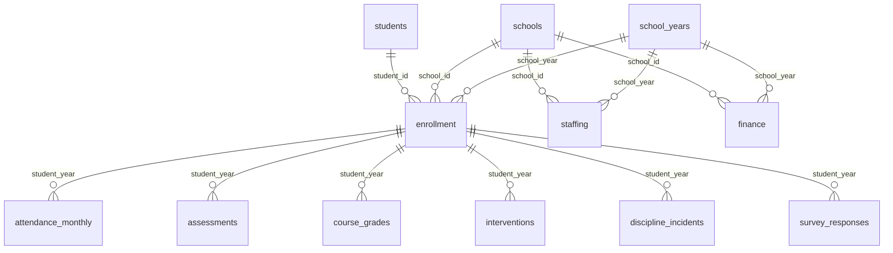

# SchoolDistrictInfo

**Entirely synthetic data for a school district analytics portfolio. No real students, schools, or district records are used.**

Practice Excel/Power Query, PostgreSQL, and Tableau on **20,000 unique students, 30 schools, 3 school years, 12 linked CSV files, and 1,079,655 records** in the fictional Cedar Valley Unified district. The goal is to demonstrate reliable analysis and clear recommendations to a school board.

Start with [project briefs](docs/PROJECTS.md), the [data dictionary](docs/DATA_DICTIONARY.md), [metric definitions](docs/METRIC_DEFINITIONS.md), and [Excel/Tableau guide](docs/EXCEL_TABLEAU.md).

## Files and grains

| CSV | Rows | One row represents |
|---|---:|---|
| students | 20,000 | Student |
| schools | 30 | School |
| school_years | 3 | Academic year |
| enrollment | 60,000 | Student-year |
| attendance_monthly | 540,000 | Student-year-month |
| assessments | 145,444 | Student-year-subject-test window |
| course_grades | 261,792 | Student-year-subject-semester |
| interventions | 14,844 | Student-year program episode |
| discipline_incidents | 6,261 | Incident involving one student |
| staffing | 360 | School-year-role |
| finance | 450 | School-year-budget category |
| survey_responses | 30,471 | Responding student-year |

All CSVs live in `data/`. Missing assessment and survey values are intentional; orphan keys and duplicate keys are not. Files fit individually in an Excel worksheet, though Power Query and the Data Model are better for repeated analysis. Preserve IDs and school years as text on import.

## PostgreSQL quick start

Install PostgreSQL separately and open a terminal **in this repository root**. Commands assume `createdb` and `psql` are on PATH and your normal database authentication is configured. Choose an empty database; do not run the schema over an existing project.

```shell
createdb schooldistrictinfo
psql -X -v ON_ERROR_STOP=1 -d schooldistrictinfo -f sql/01_schema.sql
psql -X -v ON_ERROR_STOP=1 -d schooldistrictinfo -f sql/02_load.sql
psql -X -v ON_ERROR_STOP=1 -d schooldistrictinfo -f sql/03_analytics_views.sql
psql -X -v ON_ERROR_STOP=1 -d schooldistrictinfo -f sql/04_starter_queries.sql
psql -X -v ON_ERROR_STOP=1 -d schooldistrictinfo -f sql/05_validation.sql
```

`02_load.sql` uses client-side `\copy`, so CSVs stay on your computer and do not require server filesystem permissions. The load is transactional. Repeating it into populated tables raises duplicate-key errors. Keep SQL, CSVs, and documentation from the same release.

## Relationships



Use **both student_id and school_year** for annual fact relationships and **both school_id and school_year** for school-level facts. Joining monthly attendance to course grades directly multiplies rows. `student_year_metrics`, `school_year_metrics`, and `assessment_growth` offer deliberate analytical grains.

## Reproduce and validate

Python 3.10+; no external packages. From the repository root:

```shell
python scripts/generate_data.py
python scripts/build_sql.py
python scripts/validate_data.py
```

Seed: `20261016`. The generator replaces generated CSVs, dictionary, and manifest. Validation checks hashes, counts, keys, referential integrity, constraints, and cross-file rules using SQLite. See [validation results](docs/VALIDATION_REPORT.json). PostgreSQL-specific views have been reviewed but have not been executed against a PostgreSQL server in this environment.

GitHub Actions also validates the files and executes all five SQL scripts against PostgreSQL 17, including assertions that analytical view counts, spending totals, and teacher FTE reconcile. See the repository Actions tab for the latest execution result.

## What the simulation does and does not represent

This is a **closed longitudinal cohort**, with initial grades K–10 progressing to grades 2–12 by 2025–26. There are no new entrants, withdrawals, retained students, or graduates during the observation period. Therefore the annual 20,000 headcount is intentional; the final year does not represent a complete K–12 district population. Enrollment mix, school capacity utilization, and budgets should be interpreted within this constraint. School changes occur at normal grade transitions and occasional between-year transfers; no within-year transfers are modeled.

The fictional calendar has nine 20-day months, not a real holiday calendar. Test scores use an invented common scale and thresholds, not state standards or validated growth norms. Grades cover four subjects only. Demographic and program flags are synthetic annual snapshots. Race and gender do not drive outcomes; simulated latent achievement, school effects, absence propensity, and noise do. Interventions target simulated need, so participant comparisons are confounded. Staffing and budgets are mechanically related to enrollment; they cannot establish a spending effect. Survey nonresponse is associated with absence propensity. These patterns are exercises, not evidence about real children or groups.

For public portfolio dashboards, show aggregate information and label every page **Synthetic demonstration — not an actual district**. Practice minimum-group reporting and explain suppression limits. A professional portfolio should demonstrate definition discipline, accessible charts, uncertainty, and practical next steps rather than unsupported causal claims.

## Suggested portfolio deliverables

1. Version-controlled SQL with validation and metric definitions.
2. Excel reconciliation workbook using Power Query and PivotTables.
3. Tableau dashboard with trend, subgroup, and resource views.
4. One-page board memo and five-minute presentation built from your own findings.

See [PROJECTS.md](docs/PROJECTS.md) for progressively harder briefs and acceptance criteria.
